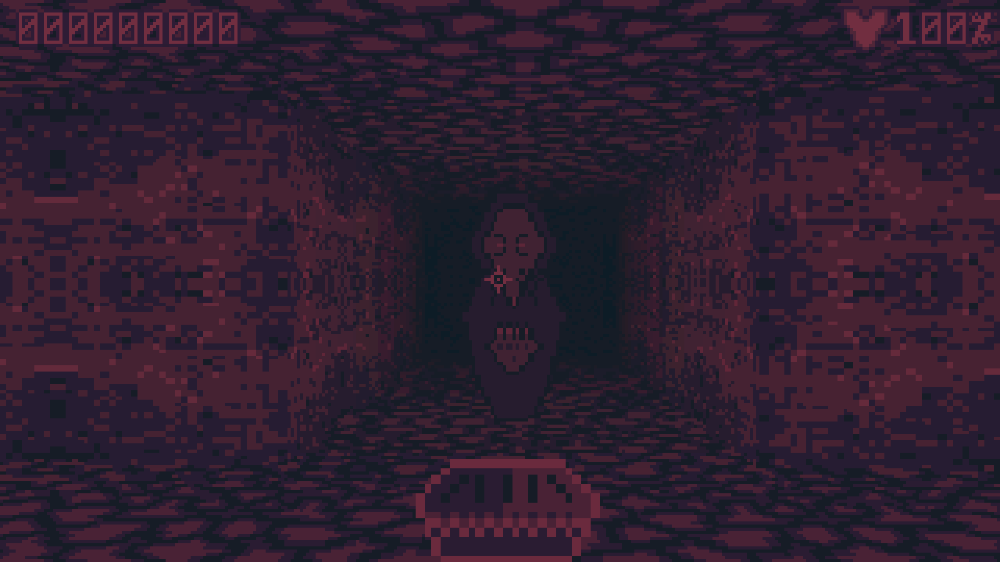
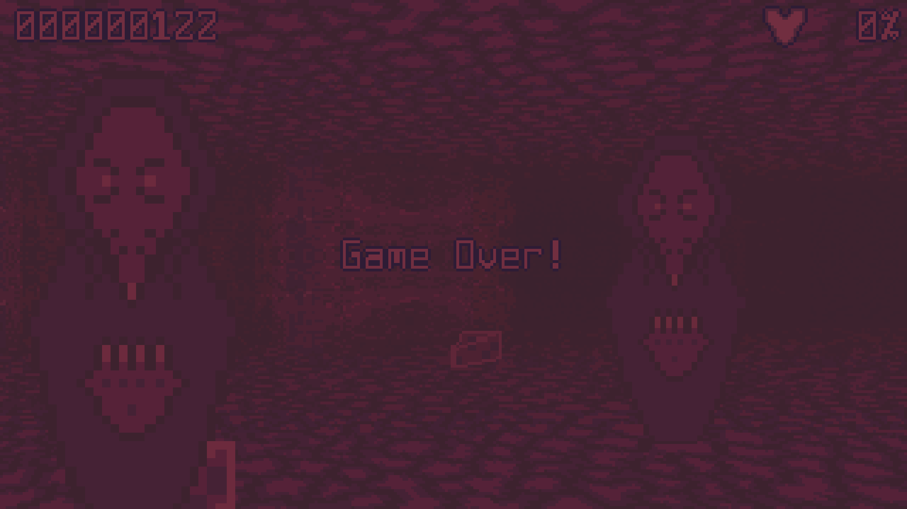
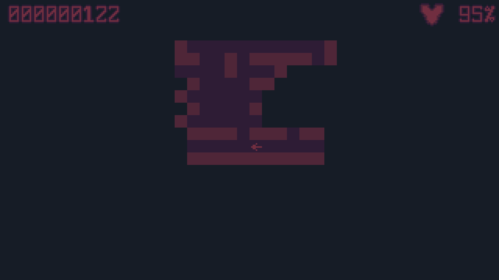
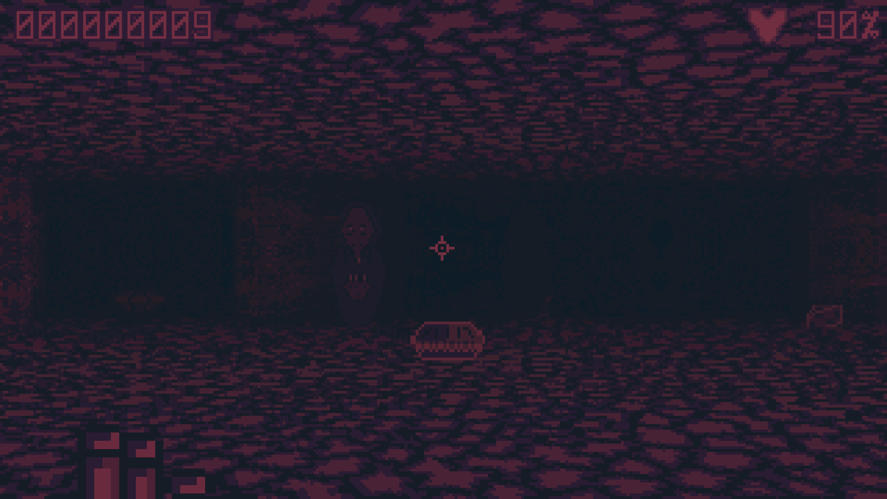

# *Rats!*

*Rats!* is a 3D dungeon crawler prototype. It uses a simple raycasting renderer to convert a 2D grid into a 3D
visualization.

## System Requirements

| Feature | Minimum |
| - | - |
| OS | Windows 10/11 or Debian Trixie |
| Processor | 64-bit Intel or AMD (x86) |
| Memory | >= 4 GiB |
| Graphics | Support for OpenGL 4.5 or newer |
| Storage | >= 1 GiB |

## Screenshots









## Controls

*Rats!* has a grid based world with slightly different rules for movement and attacking. In *Rats!*, the player and
enemies can move along any of the cardinal direction (north, south, east, and west). However, they can **attack** all
eight adjacent grid cells! That means you can attack an enemy (or be attacked by one) on a diagonal, but you cannot
move along the diagonal.

Mathematically, the rule is that you can attack any cell within `sqrt(2)` units of your center but only move `1` unit
from your center.

## Keyboard

| Key | Action |
| - | - |
| Q | Rotate Left |
| E | Rotate Right |
| W | Walk Forward |
| A | Strafe Left |
| S | Strafe Right |
| D | Walk Backward |
| Tab | Toggle Automap |
| ` | Toggle Developer Information |
| ESC (Escape) | Quit |
| Alt+Enter | Toggle Fullscreen |
| Right Control | Release mouse pointer |

## Mouse

### Motion

Left and right mouse motion rotate the camera just like the Q and E keys (mouse look). There's no vertical camera
motion (Y-shearing makes me dizzy).

### Buttons

| Button | Action |
| - | - |
| Left | Attack |

## Gameplay

The goal in *Rats!* (if there is any goal at the moment) is to maximize your total score seen in the top left of the
game window. You can increase your score by killing enemies (3 points each), collecting coins (10 points each), and
by collecting rubies (100 points each).

Enemies start the game unaware of the player. However, bumping into an enemy, attacking it, or walking through its
field of view will alert the enemy! Once an enemy is alert it will chase you and try to kill you! You can fight back
by clicking on the enemy.

You start the game at 100% health. If you get hurt, you can pick up food to heal yourself. Cheese heals 5% of your
total health. Pie heals 15% of your total health. Even at full health, you can keep eating until you reach a maximum
of 200% of your total health! If your health drops to 0%, it's game over.

Each game map is generated pseudorandomly when you start the application.

## Dependencies

*Rats!* requires a compatible C++ compiler and toolchain. Both GCC and Microsoft Visual C++ (MSVC) are supported and
*should* work. I can't make any promises about MSVC, as I primarily develop against Debian. However, I have tried to
ensure MSVC builds *just work* with Meson. Clang will probably also work. I haven't tested Clang and don't use it for
builds.

*Rats!* targets C++23, and you will need a compiler that supports it.

Dependencies generally track the versions available in Debian Stable (Trixie).

The following build time dependencies are required:

- SDL3 >= 3.2.0
- Boost.Iostreams >= 1.83.0
- WebP >= 1.5.0
- PCG Random >= 0.98.0
- Miniaudio >= 0.11.0

Additionally, you will need:

- Python 3, ideally with `pip` and `venv`
- Meson >= 1.10.0
- Ninja

To produce Debian packages, you will also need:

- `dpkg-deb`
- `dpkg-gencontrol`
- `dpkg-shlibdeps`

These are provided by the `dpkg` and `dpkg-dev` packages.

## Building

### Debian

Prior to building you should prepare a Python virtual environment and install requirements. This will install up to
date versions of Meson and Ninja. If you have adequate system versions of these, you can skip this step.

```sh
python3 -m venv .venv
source .venv/bin/activate
python3 -m pip install -r requirements.txt
```

Next run:

```sh
meson setup build --native-file amd64-linux
meson configure build -Dbuildtype=release -Dstrip=true
```

The native file is still required on Debian to configure the C and C++ compiler options for the build.

To compile the software run:

```sh
meson compile -C build
```

### Windows

Windows builds assume you have adequate libraries installed under `C:\Development` and that you install header-only
libraries under `C:\Development\Include`. For SDL3 and WebP you are also required to place a file named `VERSION`
in the root of the library directory. This file **MUST** contain the library's semantic version number. The version
data is handed off to Meson for validation. You can read the "Windows Compatibility" section of
[meson.build](meson.build) for a more specific description of what the build script expects. Many of the build
directories for Windows can be configured by editing [amd64-windows](amd64-windows).

Prior to building you should prepare a Python virtual environment and install requirements. This will install up to
date versions of Meson and Ninja. If you have adequate system versions of these, you can skip this step. To create
and activate a virtual environment in Powershell:

```ps1
python3 -m venv .venv
.venv/Scripts/Activate.ps1
python3 -m pip install -r requirements
```

Next run:

```ps1
meson setup build --vsenv --native-file amd64-windows
meson configure build -Dbuildtype=release -Dstrip=true
```

Finally, to compile the software run:

```ps1
meson compile -C build
```

After compilation, you will need to copy shared (DLL) libraries into place alongside the generated executable files.

## Installing

### Debian

On Debian, you can install directly using Meson.

```sh
meson install -C build
```

Will compile and install the program under your configured prefix (the default is `/usr/local`).

You can also build a `.deb` package and install that way. To do that, prepare a working build directory (as above) and
then run:

```sh
meson configure build -Dprefix=/usr
DESTDIR=$(realpath ./stage) meson install -C build
python3 tools/debian-package.py stage/
```

If everything works, this will produce a package at `dist/megatech-rats_*_*.deb`.

This will install `rats.*.*`, `waitkey`, and `run-and-wait.sh`. Binaries are installed under `/usr/libexec/` and
not `/usr/bin` so the easiest way to launch them is via their installed `.desktop` files. There are two `.desktop`
launcher files. One runs *Rats!* directly without a terminal shell. The other (debug) launcher will run *Rats!* inside
a terminal shell and then wait until prompted to quit (even after *Rats!* quits).

### Windows

On Windows, you can simply bundle up the required shared (DLL) libraries along side the *Rats!* binary files and the
`assets` folder. There's no need to install *Rats!* to run it.

Generally, Boost.Iostreams and WebP should be *static* libraries and not separate shared libraries. SDL3 is distributed
as a separate shared library. Your configuration might vary!

The Visual C++ Runtime is also intended to be *static linked* into the final binaries. You should not need a
redistributable.

On Windows, Meson will build two different binary files. The first runs *Rats!* as a regular Windows GUI program. The
other (debug) binary will run *Rats!* as a Windows console application. The console variant allows you to see output
from *Rats!* while the program runs. If you want to capture this output it's easiest to run *Rats!* from a terminal
(Powershell, CMD, etc.).

## License

> Rats!
> Copyright (C) 2026 Alexander Rothman
>
> This program is free software: you can redistribute it and/or modify
> it under the terms of the GNU Affero General Public License as published by
> the Free Software Foundation, either version 3 of the License, or
> (at your option) any later version.
>
> This program is distributed in the hope that it will be useful,
> but WITHOUT ANY WARRANTY; without even the implied warranty of
> MERCHANTABILITY or FITNESS FOR A PARTICULAR PURPOSE.  See the
> GNU Affero General Public License for more details.
>
> You should have received a copy of the GNU Affero General Public License
> along with this program.  If not, see <https://www.gnu.org/licenses/>.

For third-party licenses, please see [COPYING](COPYING.md).

